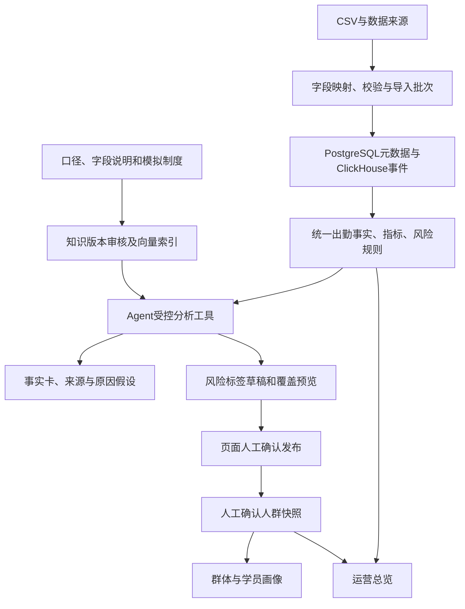

# 系统架构

## 常用任务与详情分层（2026-10-14）

- 四个常用导航，指标/渠道、标签/画像、预警/报告使用页面内导航；数据、知识、研究、系统和高级能力在工作台。URL及业务接口保持兼容。
- 总览默认四项重点指标和最多三条已有事项。读取页面不触发模型、预警评估或发布，完整指标和维度按需展开。
- 范围抽屉编辑临时输入，应用后更新页面；标签在编辑保护通过后才同步URL；Agent新范围进入新会话，历史保留。多个未保存编辑依次保护。
- 分析默认摘要三行、最多三项事实与建议，原文可展开；假设/限制/引用及执行记录不删除。新提示结论先行，历史JSONB不重写。
- 标签只展开当前一步，发布和保存人群独立确认。知识默认列表，模板/检索/版本/帮助按需查看；流程引导主动选择后才显示，进度绑定真实对象编号。
- 不新增表、迁移或框架；未知、失败、模拟来源和历史批次差异仍有明确提示。

本轮变更集中在导航/总览与公共范围栏、Agent/报告结果阅读、标签/人群/画像四步流程、知识/帮助页面。新增的RangeEditor只管理当前编辑状态及目录查询，应用才改变会话范围；模型输出仍保存原完整结构。知识手机布局将状态和主操作移入材料列，避免横向查找。范围编辑按需挂载，日期对象仅在日期值变化时重新生成，目录加载不会覆盖输入。

项目面向单机构、多校区的运营管理。技术基础为Next.js、React、TypeScript、Ant Design、PostgreSQL/pgvector与ClickHouse；Redis可选。PostgreSQL通过pg连接池和参数化SQL访问。

## 模块与职责

| 模块 | 实际职责 |
|---|---|
| identity | 本地密码登录、JWT、账号和角色 |
| data | 数据源、模型、字段映射、教育CSV导入入口 |
| education | 数据集、批次质量、元数据/事件、统一出勤事实 |
| tag | 分类、版本、目标表、位图/物化视图有效能力、风险草稿与发布 |
| segment | 人群管理、已发布风险标签的成员快照 |
| profile | 人群与成员的真实出勤画像 |
| analytics | 八项运营指标、周期对比、趋势与维度拆解 |
| alert | 演示规则、冻结命中依据、状态处理及版本校验 |
| report | 周/月冻结数据、只读工具生成、历史详情和Markdown导出 |
| knowledge | 知识来源、审核版本、切块、向量索引与检索 |
| agent | 固定范围的会话、六工具循环、执行记录和人工确认联动 |
| overview | 经营指标、资源状态及已确认人群入口 |
| system | 账号管理辅助、设置、审计和回收站 |

页面、布局和HTTP入口在app；模块按需保留ui、domain、services、repositories和contracts。services编排用例，domain保存纯规则，repositories实现具体存储。composition装配服务，不继续保留重复的adapter/impl/interfaces层。共享组件与通用契约位于shared，连接和外部客户端位于platform。

通用实体类型直接使用内部配置；原标识仍可回显。位图的UInt64掩码使用BigInt生成，同步以标签值及更新时间识别最新状态，保留撤销/NULL信息；更新目标位时保留其他位，等待清除完成后写入新命中，返回实际处理数量。

跨模块通过server、client和contracts入口；客户端不能间接引入数据库或密钥。实体类型为项目内部学员、家长、线索选项，旧业务标识可回显，不依赖独立字典管理系统。

## 数据流

当前经营数字来自业务查询，RAG补充解释知识。模型只接收聚合结果、规则与证据摘要；成员资料保留在业务页面。事实、待验证原因和建议分别表达。

## 数据库与一致性

PostgreSQL保存账号、业务元数据、标签、人群、风险草稿/冻结预览、知识版本/向量块和Agent会话/执行。教育事件在ClickHouse的education_events_v1中。所有记录带机构/数据集/批次，查询只读取完成批次。

薄数据库层提供连接池、queryRows/queryOne、execute、transaction及行字段转换。查询显式参数绑定；事务通过同一连接执行，失败回滚后释放。历史snake_case表与新业务camelCase表保持现有字段，后者在SQL中明确加引号。数据库类型由所属模块定义，日期及JSON响应保持接口格式。

导入预约、风险发布、知识版本切换和Agent幂等采用事务锁与条件更新；保留唯一约束，不以先查后写替代并发保护。风险预览绑定规则版本、token和完成批次指纹，快照成员从发布事实复制，后续导入不改写历史快照。

## 智能辅助边界

知识正文最多20,000字符，按标题/段落切块，块上限800字符、重叠100字符。只有本机构、已审核、索引完成、当前版本且向量模型/配置指纹/维数一致的块进入精确余弦检索，默认最多5块、相似度下限0.35。新版成功后事务切换，历史版本可追溯；失败不取代旧版。

Agent请求内执行，最多6轮模型请求、8次工具、120秒；单次模型请求60秒。会话范围不可扩大，写工具不自动重试。标签与人群确认不注册为模型工具；聊天里的确认文字不能发布。

收尾阶段在必要工具返回后停用工具选择，明确要求JSON对象响应；模型适配器仅在收尾或受控纠正时设置response_format=json_object。五字段回答使用共同的类型、长度限制和示例；服务端列出本次事实ID白名单，知识来源ID不能充当事实ID。出现无效JSON或正文自编数字时，最多一次只读格式纠正，仍占用原六轮及总时限预算，且不执行写入工具。纠正提示只含安全字段路径和错误代码，不回显原供应商响应。事实ID和数字校验继续生效，无法纠正则保存失败及已有证据/草稿，不能冒充成功。报告在两个只读工具完成后同样进入JSON收尾。接口配置与知识索引保持独立。

## 运行与当前限制

新环境只使用database/init.sql一次初始化，启用vector扩展并创建有效表/索引。已有数据库检查结构后继续使用，应用启动不运行初始化或迁移。根Compose保留既有数据卷，app/tools/cache为可选profile。

模拟经营计算保留内存聚合和全量风险预览，公开学习已采用数据库聚合。导入与Agent为同步执行；经营数据库聚合、大规模分页和后台队列仍是后续优化。渠道筛选、通用规则执行、后台队列和建议采用评价仍待完善。

## 全量公开学习分析

公开学习查询使用PostgreSQL元数据聚合与ClickHouse完成批次聚合，禁止调用全量教育快照。ClickHouse使用参数化POST、FINAL与范围过滤，趋势/课程/资源通过数据库分组产生；应用只接收有界图表结果与字段字典。两个聚合任务并发，单查询限制线程和内存并允许外部分组落盘。本轮不新增业务表，复用现有记录及JSONB范围。

LearningScope包含courseKeys和可选相对日起止；服务器绑定机构，验证课程属于当前数据集。经营范围与学习范围互斥，公开数据不接受经营标签和报告操作。Agent学习注册表只有query_learning_metrics及search_knowledge，不能调用经营写入工具；已保存学习会话固定课程与相对日，历史经营会话继续按原日期读取。RAG学习检索排除历史经营摘要，来源版本引用保持原审核规则。

CLI流式导入复用一次建立的基础引用索引；行为记录仅留当前分块。查重只请求本块来源编号和完成批次；HTTP POST保留参数绑定，超32KiB的类型化数组拆分参数后以arrayConcat合并，避免ClickHouse 24.8表单字段上限。文件SHA、预期行数与来源行偏移共同形成可重入导入，检查点与批次完成状态互相核验。失败/运行批次不能参与聚合；残留运行任务仅在明确验证旧进程退出后恢复，不能自动当作成功。来源文件变化拒绝复用旧数据集。

学习总览与模拟经营总览由同一个数据集入口选择，公开默认按已导入相对日完整范围展示。最终学习结果只描述课程批次最终状态，与历史时点活跃图分开解释。登录页及各日期筛选统一适配窄屏。NEXT_DIST_DIR可选为.next-validation，支持验收生产构建与正常开发缓存分开，默认仍使用.next。

## 本轮报告、预警与补表

`operational_alert`保存规则命中与本期/对比期数字、来源批次、处理版本。相同范围用事务锁串行评估，相同指纹保留已处理状态；新批次评估让旧结果退出有效列表。关注/处理使用机构、版本及有效状态条件更新，模型不参与状态修改。

`operational_report`保存不可变的计算快照、事实卡、工具执行与知识版本引用。请求按机构、用户、UUID幂等键唯一并绑定内容；同键同请求复用，内容变化拒绝。先入库快照，再生成正文；完成仅接受未过期的生成状态，超时/失败保留数据。历史报告不会重新查询数字或被后续导入覆盖。

报告仅有query_report_facts和search_report_knowledge两个只读工具，最多六轮、八次工具，生成时限两分钟；不能调用标签草稿、发布或人群工具。RAG只检索审核完成的当前定义、制度与案例，排除历史分析摘要。正文引用已有事实ID，拒绝自编数字。所有数值表格由程序渲染，不以模板冒充模型生成成功。

**已有数据库的手动补表说明**：先备份并核对当前库结构；在数据库工具打开唯一的`database/init.sql`，只选择`BEGIN OPERATIONS`至`END OPERATIONS`间的两张新表和索引，在独立事务中执行并核对结果。原30张表、数据及已发布快照均无需改写。已有新表时核对定义后跳过该区块，不能重新运行整份初始化SQL。应用与部署不自动补表；未补表时报告/预警显示服务不可用。新空库一次执行完整初始化，共32张表。

## 运营标签扩展与评审展示

本轮不新增表、不迁移历史数据。risk草稿、预览、人群和Agent沿用JSONB记录；出勤单条件仍使用attendance-v1，新增业务规则和组合使用business-rules-v1。旧出勤标签和快照保持原计算含义，未保存的经营事实不补零。

education统一生成截至期末的“学员＋校区＋课程”事实：签到、有效合约、续费资格、累计净课耗、退款及按发生时间保存的客诉。tag先逐上下文评价真/假/未知，再按学员去重；all中任一假为假，否则有未知为未知，any中任一真为真，否则有未知为未知。跨课程或跨校区的两个条件不拼接。

总览POST查询读取一份教育快照，复用指标计算器产生本期、对比期、六个历史月份和每个维度的指标。比率使用分子分母重新计算，不平均百分比。经营记录、预警、报告、草稿、人群均按同数据集、周期、有效截止及校区课程匹配；冻结结果保留批次，新批次与历史结果不一致时标明历史。

公共图表采用ECharts按需模块、SVG渲染和ResizeObserver，离页释放资源，保留表格入口、空态、未知断点及减少动画偏好。浅色默认、主题可保存，蓝青用于分析、紫色用于Agent、橙色用于真实异常；没有循环背景动画。

评审引导位于真实页面。入口仅预填范围和问题；本地只保存用户/场景/范围对应的记录编号。服务端重新核验执行、草稿、人群和报告，范围不一致不计进度；模型调用、评估、发布和人群创建都需明确页面操作。模型不能确认发布或建立正式人群。

## 决策、财务与指南模块（2026-10-12）

finance读取既有education_record中的finance_annual元数据及完成批次，保存原始金额字符串（人民币元，两位小数）；按分计算毛利，比例与同比由程序计算。显式analysisType优先，旧模拟与OULAD标识兼容识别；任意未知公开来源不能自动识别为OULAD。总览、Agent和接口互斥选择经营／学习／年度财务范围。财务工具只读，经营新增固定范围的校区／课程拆解，同一次拆解复用经营快照，各组独立算分子分母。

新增decision任务和feedback操作历史，按机构隔离；来源为成功Agent回答或报告中的具体建议序号，保留不可变来源快照。来源唯一约束避免重复任务，请求键绑定内容，反馈加行锁、版本检查和幂等键；运营人员只能分配自己，管理员可分配本机构启用的操作账号。人群关联校验同数据集与范围，集团财务不能关联模拟学员。状态：已采纳→执行中→待复核→已复核；暂缓可采纳或拒绝，已结束不可追加执行。

analysis_evaluation绑定报告冻结数据指纹，保存三种方案及失败状态；原工具报告不重新算数，模板明示模板，直接模型不使用工具、不做数值纠正。人工五维评分、评分者和评分历史分别保存，不制造真实采用率。help为手写应用页面和真实截图，不使用文档扫描／生成链。

已有库追加：仅提取唯一初始化SQL中的DECISION_APPEND_ONLY区块执行，先检查连接为预期库并保存已有对象计数，执行后核对旧业务对象未改变。区块只新增education_dataset.analysisType及三张表／索引，没有DROP、TRUNCATE、数据改写或历史迁移目录；应用启动不执行DDL。测试破坏场景只允许专用_test环境。

## 本轮交互与流程核验

新增共享范围摘要、Markdown阅读组件及编辑保护。Markdown使用react-markdown/remark-gfm，跳过HTML，限制链接协议，不加载正文中的远程图片。临时输入缓存只存在客户端内存，用户切换后清空；正式草稿及任务使用原存储。

Agent首次POST保持请求内执行，通过requestKey提前找到已准备记录并显示持久化工具步骤。进度查询直接读仓储，超时仅返回expired，不调用finish或历史报告expire。每2秒串行轮询，终止状态、截止或卸载时停止。

journey查询仅读取本机构数据，按run→proposal→发布版本→成员快照及明确report/task节点核验。报告本身没有人群关联，只列同范围成功候选，由用户选择；任务来源和关联人群必须匹配。指标“本次已查看”是本浏览器状态，不能当作跨设备完成记录。URL及本地指针帮助恢复，服务端记录仍是事实依据。本轮无新表和DDL。

侧栏、页面链接、退出登录和浏览器历史导航共用当前编辑保护。核心菜单沿用经营范围；学习及财务只向相应只读页面传递各自范围。运营草稿编辑保留原渠道筛选，不因界面未显示该筛选而清空。

从人群或任务恢复时，先按冻结标签及版本定位草稿，再按本机构执行记录中的实际草稿编号定位唯一Agent运行；没有唯一关联则不猜测。切换为其他草稿清除旧运行与下游指针；修改同一草稿保留运行来源并提示版本差异。报告选择变更清除旧任务指针。

## 研究评价、渠道与复核（2026-10-13）

研究评价页面独立于决策操作。成功经营报告的JSONB快照保存实际模型名称、提示版本、事实、检索知识原文与版本、各轮模型输入；比较记录复用原评价表的answer JSONB保存评价上下文。模板、直接模型和工具报告绑定相同共享输入指纹。历史缺失输入的样本保留可读，但不进入严格评分汇总。自由正文仅标出疑似数字供人工语义核对，程序只验证结构化事实值、单位、分子分母及引用。评分历史只追加，每个账号对同一方案的最新评分计入均分；无评分留空。

渠道归属使用学员＋校区＋课程的首次有效首购和明确来源线索，续费沿有效合约链继承。截止后才发生的记录不影响历史归属；缺失、循环或冲突归入未知。经营范围中的channelIds贯穿看板、Agent、标签预览、画像、人群和报告。渠道范围的班额指标显示为渠道席位贡献率，不能套用满班不足阈值。经营、公开学习、年度财务三个来源继续隔离。

决策目标只在建立任务、执行前确定，最多三个指标。任务goals与反馈quantitativeReview为可空JSONB字段；历史任务无目标时只作描述性对比。服务端只读预览计算前后指标及证据，页面确认时重新计算并核验任务版本、批次及预览签名，事务内再检查批次。后续周期未结束、样本不足或口径不一致不作达成判断。冻结复核仍属于观察结果，不能据此证明因果。

预警配置及修改历史位于机构system_config.config.alertRules，局部更新不覆盖已有设置。管理员发布配置并校验版本，运营人员使用已发布配置。命中结果冻结实际配置；改配置不会重写历史警报。历史回放纯读，明确区分命中、未命中、停用和数据不足，人工标注由独立场景或真实核对记录提供。

已有数据库只执行唯一database/init.sql的BEGIN RESEARCH_APPEND_ONLY与END RESEARCH_APPEND_ONLY之间区块，增加两个可空字段和必要索引。不执行整份初始化SQL，不清空原库。正常追加与测试追加工具位于tests/e2e/prepare-research-schema.mjs，须明确选择环境并验证前后记录计数。空库仍一次执行完整初始化。

## 经营计算与名单规模

经营查询从 PostgreSQL 取得业务关联，ClickHouse 聚合签到、净课耗、退款、招生及续费；应用只接收聚合数字、趋势和有限维度结果。prepared 查询复用本次元数据与批次。纯计算器保留为独立核验基准。标签规则按100名学员分批读取事实，同一学员的校区课程及续费链不分拆，计算后再核对批次未改变；只累积实际命中成员，不累积所有行为记录。

人群摘要不读取JSONB完整成员，名单在数据库内按序号分页；画像全体分布由数据库聚合，与当前名单页分开。导出每批100人串行读取。旧无分页接口兼容保留，界面及Agent默认使用摘要或分页接口。

性能夹具仅写专用_test库，固定种子并保存实际规模；新进程测量冷组并明确未清OS页缓存，暖组先预热。诊断只读连接、必要结构及模型配置，不联网探测模型，不显示密钥，不初始化数据库。

研究对照允许选择已结束的成功或失败报告。失败工具报告以原错误和失败状态进入同冻结数据比较，不能只汇总成功样本。模板仍明示模板、直接模型仍不纠正正文数字；失败工具项不可评分。原报告永不覆盖。报告正文在剩余六轮上限内最多修正两次，不重执行工具、不放宽数字校验。
