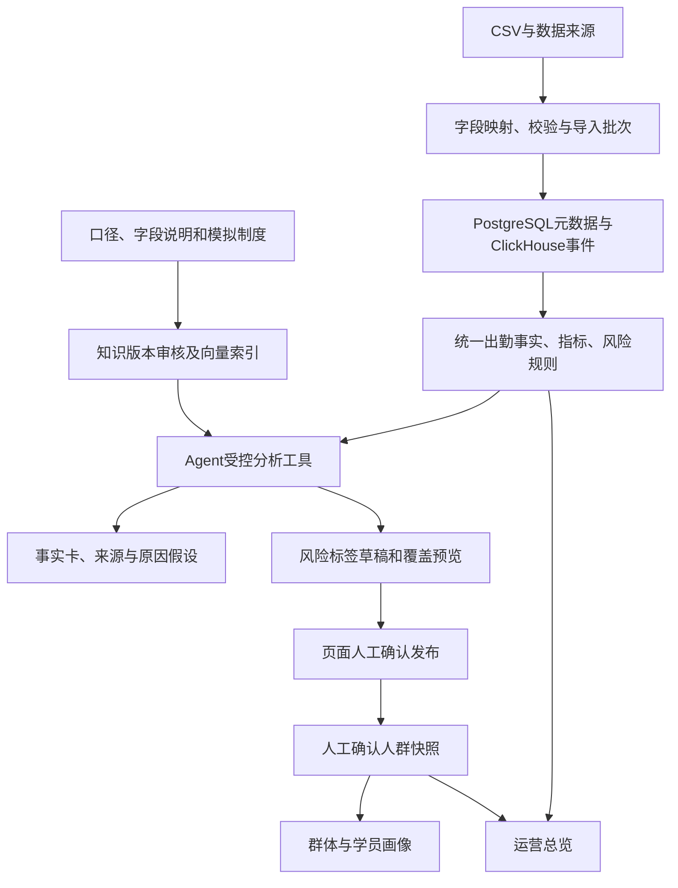

# 系统架构

## 空间感AI产品前端（2026-10-19）

参考Attio的操作层次、Raycast的光影构图和Linear的产品编排，使用本项目原创素材重构登录、总览、Agent、工作台与行动中心。原四导航、URL、业务接口及数据存储沿用。总览四指标信息带与所选指标／主图组合，事项采用编号清单；Agent保留连续双区及12px输入间距，结果区按不同内容分版式；工作台两重点加四紧凑入口，行动详情为执行简报与折叠依据。

公共Workspace只负责进入时的420ms透明度／位置过渡，不按路由重新key业务组件；明确操作使用220—280ms过渡，状态节点来自实际工具steps。历史切换、主题变化及轮询不重新挂载页面或播放整页进入。减少动画模式关闭上述动效；没有动画框架、视频背景、数字滚动或假进度。

VisualArtwork统一使用next/image加载项目内素材，固定容器避免布局跳动；登录图优先，其他按需加载。断载保留底色、文字和操作。Agent PNG实际alpha范围0—255，原图不转成不透明底；本轮不调整后端、模型配置或数据库。

Windows独立包显式追踪@img/sharp-win32-x64/lib中的DLL，避免原生编码器未收录时优化器静默回传原始PNG。按[Next.js独立部署与依赖追踪说明](https://nextjs.org/docs/app/api-reference/config/next-config-js/output)增加窄范围outputFileTracingIncludes，不复制整个依赖树；验收实际输出的编码、宽度、体积及透明通道，HTTP 200或成功解码不能单独证明压缩已生效。

素材由内置imagegen生成（2026-10-19），原文件复制入public/visuals，未使用参考网站的品牌图。登录图login-spatial.png为1536×1024，Agent图agent-spatial.png为1254×1254，工作台图workbench-spatial.png为2172×724；它们只承担视觉表达，不是业务数据或分析证据。完整提示采用下列共同提示加各自构图提示：

<details><summary>三张原创图片的生成提示</summary>

共同提示：Create an original premium 3D art asset for EduOps AI, a business analytics application. Art direction: sculptural translucent glass, satin blue-violet ribbons, a small mint light accent, deep midnight navy, believable soft studio lighting, rich tactile detail, restrained luxury product photography. Pure artwork only: absolutely no text, letters, numbers, logo, UI, screenshots, charts, school children or identifiable people. The image must be a polished raster render, not a diagram or vector drawing.

登录构图：Wide landscape composition around 3:2. A large elegant loop of milky optical glass intersects a flowing indigo satin ribbon above a dark slate pedestal. Beautiful caustics, delicate grain, subtle pale teal reflections. Sculptural forms occupy lower center and right; the upper left quarter is quiet very dark navy negative space for separately rendered headline text. Background is a seamless dark navy studio with gentle atmosphere. Clean silhouette, photographic depth, avoid wireframes, neon cyberpunk, excessive tiny dots, garish glow.

Agent构图（transparent_background=true）：A single compact floating sculpture of two interlocking translucent lavender and icy-blue glass loops around a small opalescent core, one short satin indigo ribbon and subtle mint highlight. 1:1 square, centered, entire object visible with generous padding on all sides. True transparent background, no backdrop, no floor rectangle and no checkerboard painted into image. A refined dimensional icon-art object that looks beautiful on both a light and a dark application canvas. No shadow cast onto an opaque background.

工作台构图：Wide panoramic composition around 3:1. A close architectural crop of overlapping curved glass sheets and folded indigo satin surfaces, lit along the edges by soft mint and pale lilac light. Sculptures gather toward the right two thirds. Left third is quiet deep navy negative space for live interface text. Real materials and smooth deep shadows, sophisticated editorial still life, no graphs or fake business data. Art direction must coordinate with a glass-loop login sculpture and glass-loop AI assistant emblem.

</details>

## Agent输入区布局（2026-10-19）

输入框与底部操作采用独立网格行和12px行间距；底部使用可换行提示列与固定按钮列，不依赖Ant Design Flex的外边距。输入保留2—4行自动增高，输入法组词期间不执行快捷发送。对话滚动区新增相对定位容器，“查看新消息”锚定该区域底部12px，不再按输入区高度硬编码偏移。沿用原会话、草稿、请求及模型执行逻辑。

## 经营分析完整性与部分结果（2026-10-19）

主指标模型结果只提供实际factId映射，删除混入的breakdown、unknown/details与未注册的旧分子分母／趋势计数。程序原始facts保留样本供页面展示，模型投影去计数；专用query_metric_breakdown支持可选metricCodes并同时过滤事实、分组和程序图表，缺省仍兼容八项。

建议与候选操作中的单次人工动作、再查询／再确认一次属于未来操作意图，和已发生业务次数分开；过去事件、退款执行、人数及金额仍严格核验。当前提示版本evidence-complete-v5保留实际输入与错误路径，不能凭显示标签推算模型成功率。

对明确提出的经营维度分析，结束前检查同一evidenceScopeKey下已完成的query_metrics和相应维度查询，指标筛选须覆盖请求。缺项时最多两次提示补已授权只读工具，占用原六轮／八工具预算；不进入关闭工具的格式修正流程，仍缺则INCOMPLETE_ANALYSIS。历史助手内容只投影状态与澄清，旧建议只保留操作来源索引；不将旧数字／旧结论重新喂成当前事实，原历史页面不改写。

模型解读错误且已有同范围、成功步骤、有证据事实时，answer.partial={kind:facts_only,reasonCode,missingTools?}保存程序结果；原status仍failed、CapabilityResult仍error，研究统计不算完整成功。被拒的模型正文、假设、建议全部丢弃，不删除数字后继续展示。页面用橙色“部分完成”区别数据成功与分析未完成。缺维度查询的源记录拒绝仅解读恢复，包括从旧保存输入可核验原问题的历史记录；无新增状态、表或接口。

## 出勤解读数字校验修复（2026-10-19）

数字绑定增加本轮去重事实的fN短引用和labelN名称引用；完整fact引用继续兼容，渲染后仍使用原事实编号及证据。事实非ready时统一显示未知，不读取遗留value或displayValue。原经营数值、金额、比率和规则参数继续要求绑定，不能因数值在返回结果中出现过便直接放行。

日历文字单独校验：仅当前授权周期及具有证据、ready的对比期／趋势事实提供可用月份与边界日期；跨年裸月份有歧义时须用带年份形式或占位引用。建议中的命令式单次回访、提醒等可作为行动次数，过去已发生次数仍须绑定。格式修正沿用单次预算，使用短引用且保留analysis与有效事实，不重做已完成工具。普通运行和仅解读恢复统一使用此逻辑。

既有steps.runtime增加可选answerValidation，最多保存最近两次失败的轮次、错误码和字段路径；不保存被拒正文、成员信息或密钥，HTTP原脱敏边界不返回内部输入。不新增表、接口、迁移或模型框架，原失败不覆盖。

## Agent上下文操作、程序图表与等待交互（2026-10-19）

结果区的ContextActions由已保存运行、问题、事实、提案、计划、来源模式、权限和范围关系确定，最多两个下一步。普通单项补参直接发起下一轮；多项问题完整选择后合并提交；操作性回答先填入输入区。任何正式业务写入继续走原页面确认。跨范围动作先明确使用所选回答范围，不静默改用当前范围。关键事实优先问题相关主值和已计算变化／对比，分子分母仍保留在完整依据。

visualizations是业务工具直接提供的可选结构化数据，单步最多8图、每图30类和3个系列，单位分别绘制。运行服务校验模式、数据集、公共范围与证据后保存至既有steps JSONB，不将图表配置送给模型。页面先按当前问题的指标、再按图形类型排列，保留最多8图，复用BusinessChart一次展示一图及数据表；未知保留空值与断点。仅解读恢复从原成功步骤复制同一冻结范围的图表，不新增查询、推导数字或改写旧记录。

等待状态分开控制提交和浏览：同一会话有运行时不可再次发送、改规则或确认，但可以起草、查看已存回答及其他会话。切换会话只解除当前浏览请求，服务端仍按原请求记录执行；晚到响应经视图代号、身份和AbortSignal核对，不注入另一会话。输入按会话存入现有身份隔离的应用内存缓冲，新运行完成不能清除后来编辑的文字；关闭窗口沿用离开提醒，无永久草稿表。

系统设置GET经已验证公司身份，只SELECT，不存在时返回原默认值，不创建记录。PUT显式保存并原子合并JSONB配置，保留其他配置片段，写SystemConfig审计；缺身份不回退系统机构。无新增业务表、队列或迁移目录。

## Agent任务记忆、工具路由与解读恢复（2026-10-18）

agent_session.taskState保存可空JSONB任务状态，含revision、明确目标、用户条件、已选对象引用、待补问题及范围指纹。prepare在会话事务锁内提取用户明确输入，变化后递增版本；每轮context.runtime.taskMemory保存当时快照。明确替换条件时移除旧限制，补充条件才追加。显式PATCH检查会话可继续权限、运行状态及expectedRevision，finish采用CAS避免覆盖较新任务。对象在使用前经所属模块重新核验归属、范围和版本；记忆不包含成员名单或可当作当前指标的历史数字。

页面确认产生的实际人群、任务和报告，在正式结果提交后由独立短事务补入记忆：只锁会话，执行记录使用普通读取，避免锁顺序反转。当前目标、条件、范围和修订号必须匹配；completionReceipt记录同一计划最近一次补充的修订号，允许部分成功后的继续处理。用户新目标或后续分析优先，无变化不递增版本，补充失败不改变正式业务结果。

现有工具分guidance、analysis、tag、workflow、knowledge五组。初选由当前用户原文及已核验记忆确定，不增加模型分类请求；select_task_tools最多切换两次并占用原8次工具预算。执行白名单同时受角色、来源模式、任务组及本次模型实际收到的工具定义约束。每轮仍最多6次模型调用、120秒。学习与财务不能借切组访问经营工具。

原context.runtime.freeze保存范围指纹、数据指纹及实际知识版本。对象定位的taskScopeKey按公共业务范围核对，冻结分析另用evidenceScopeKey保留观察截止，避免同一月份不同观察窗口的事实混用。导入完成批次、财务披露记录和可变任务／报告／预警元数据参与数据指纹；查询前后变化时拒绝混合依据。各模块只返回必要元数据摘要，不加载业务正文。知识版本沿原证据核查，草稿不可用于恢复。

retry-interpretation服务仅加载原已结束失败运行的事实、证据和范围，验证后使用prepareRecovery创建新运行，记录recoveryOf。新运行只有context和restore_frozen_facts，不复制工具输入、草稿或操作计划；模型无工具，最多一次格式纠正，短暂HTTP异常沿用一次受控重试且占用原调用预算。恢复不更新会话的scope、taskState或updatedAt；原失败保留。原依据变化或历史记录缺少freeze时要求重新查询。

引擎版本为business-agent-v3，逐轮记录实际toolNames；HTTP只返回安全路由概要与输入摘要，不返回模型输入、完整工具schema或内部冻结元数据。研究评价区分完整业务任务与interpretation_recovery，恢复的零业务调用不计为业务闭环完成。

已有库仅追加以下区块，不执行整份初始化：

```sql
ALTER TABLE agent_session ADD COLUMN IF NOT EXISTS "taskState" JSONB;
```

初始化SQL有同名标记区块，项目本地追加工具仅支持显式normal-append或test-append，并核对数据库、字段范围及原记录计数；不新建业务表或迁移目录。

## 独立个人工作台（2026-10-18）

工作台从菜单抽屉改为/dashboard/workbench独立页面，页面和聚合归overview模块。入口目录统一保存路径、分组、说明和可见角色；四个主业务分组不变，工作台及其目录页面单独高亮，不生成大型次级导航。登录仍进入运营总览，进入工作台不继承来源页的范围与对象编号。

个人工作区使用2∶1待办／最近工作分区，平板手机切换分区；常用六入口独立显示，全部功能按数据、知识研究、系统、高级分组，搜索时包含常用业务入口。view、q、type、page、mobilePane保存到URL以支持返回与刷新；原生history传null，请求使用AbortSignal和身份键，防止旧请求覆盖新筛选。

GET /api/workbench在已验证公司上下文中，仅聚合当前账号的有界元数据。decision、agent、knowledge、report、tag、segment各自通过server公开读取方法执行本模块SQL，再由overview合并排序分页。任务按负责人，方案按执行创建者，知识按全机构真实最新版本确定后再筛创建者；最近工作最多六条。没有完整报告、模型输入、知识正文、步骤和成员快照进入首页请求。

各分区独立呈现ready／partial／error，读取失败的数量保持null；全部待办数只在三类数量均已知时计算。读取不调用有超时清理副作用的原报告／Agent详情服务，不执行模型、预警、发布或审核。无新业务表、迁移、访问历史或收藏存储；现有服务端鉴权仍为最终权限边界。

## 分区工作台布局（2026-10-17）

本轮以shared/ui/Workspace提供工具栏、分区网格、带独立滚动的内容区及不覆盖正文的底部操作区。组件仅控制布局；数据请求、选中对象、编辑保护和业务操作继续归所属模块。公共外框使用88px带文字导航、56px页头，按有无页内导航计算可用高度；模块自行处理平板和手机的详情切换。

总览使用紧凑指标带、主分析图与右侧事项；智能分析采用55∶45对话／结果双区，会话列表按需打开，输入不随长结果滚出页面。选中历史消息只切换对应轮次，结果使用该轮冻结来源与范围。标签采用草稿／规则名单／操作摘要，人群复用profile公开客户端画像面板；行动、知识、报告采用目录与详情，报告独立详情复用单一阅读组件。

选择对象同步URL并支持刷新、返回；过时读取使用AbortSignal取消。useBusinessApi增加第四个可选signal参数，兼容已有调用，不改变鉴权头、请求方式和业务契约。分区不增加后台接口、模型工具、业务表或自动写入；人工确认、版本、未知人数、公司连接和证据保留。

原生history写入使用null，让Next.js同步搜索参数；复用旧history.state中的内部标记会使地址变更但选中对象未更新。相同地址不新增历史项；取消旧请求、明确对象错误与返回无对象状态分别处理。标签步骤采用可聚焦的四等列按钮，移动端图标与文字上下排列；侧栏中文名称和固定操作区使用实际元素尺寸检查。

首轮先完成代码、指南和文档，再集中检查。本轮的结构验收以栏位、滚动容器、首屏图表及固定输入为准，旧配色截图不能代替本轮布局验收。

## 杂志式数据界面（2026-10-15）

统一设计源为shared/theme/palette.ts，集中定义浅／深色配色、系统字体和CSS变量；theme.config.ts将同一组值映射到Ant Design，ThemeProvider只负责偏好及变量应用，根布局提供浅色首屏默认值。公共CSS负责布局与通用状态，专属构图由各模块CSS Module管理，不在页面重复建立主题Provider。默认浅色，沿用education-theme偏好。

深墨导航、暖白画布、青绿选中指标和局部紫色分析结论建立视觉重点；四项主导航和所有原URL保留。总览标题合并数据集选择，主趋势／校区对比为2∶1；智能分析控制阅读宽度，操作确认卡独立呈现；标签／人群／画像及行动中心保留实际操作流程。其他页面继承公共标题、表单、表格及状态样式。

BusinessChart和chart-options读取同一配色及字体，保留ResizeObserver、资源释放、主题切换、空结果、真实零值、未知断点及数据表入口。所有装饰仅为CSS或SVG，不代替实际指标，不增加请求。响应式布局及减少动画偏好由公共样式和模块样式共同处理。本轮不改API、数据库、模型配置、公司隔离或人工确认规则。

## 连续协作Agent与独立公司数据库（2026-10-14）

本轮将公司连接路由作为全系统基础，Agent在业务工具网关内执行。每家公司分别拥有PostgreSQL业务库与ClickHouse事件库，账号、知识、会话、标签、人群、报告和决策记录均留在所属公司；数据库实例可以共用。原公司映射现有数据库，不迁移或重新初始化。

- 公司注册表仅保存名称、编号、代码和环境变量引用，实际连接由服务端解析。登录选择公司并在该公司的local_user验证；JWT每次请求重查启用状态、当前角色和所属公司。
- API统一通过withCompanyRoute验证身份，再用AsyncLocalStorage.run绑定数据库上下文。缺上下文、未知公司或重复配置为同一数据库均拒绝；外部身份头不能选择连接。CLI通过runCompanyCommand显式选择公司。
- PostgreSQL池、ClickHouse客户端/建表检查及Redis缓存按公司区分；客户端身份变化中止旧请求、清缓存并卸载工作区。仅专用_test测试入口可显式装载测试默认上下文。
- 工具网关校验严格参数、模式、角色和范围，调用已有业务服务。模型不能传SQL、公司身份、连接或确认凭据；正式动作没有模型执行工具。
- 回答区分交流、澄清、分析与操作准备。教程和问候不必查询数据库；分析事实来自本轮工具。数值通过事实占位符由程序渲染，日期/参数来自已验证范围与规则。
- 会话固定公司，范围可以在后续轮次明确调整。每轮在steps JSONB保存context；变更前为旧记录补充原范围元数据，不改写回答、数字或证据。决策来源使用执行自身范围，不使用会话最新范围。
- 已保存对象可在后续对话定位和继续操作；有歧义时询问。公开学习、经营、财务使用不同工具集合，不混算。
- 操作计划保存在执行steps JSONB，包含版本、步骤、证据、批次、预览有效期及执行记录。正式操作由确认接口串行执行，逐步幂等，失败保留已完成对象；不宣称跨服务的多步操作具有单一数据库事务的原子性。
- 知识只自动保存草稿，人工审核和索引规则保持。标签发布、人群保存、报告生成和任务建立可集中确认；删除、权限变更、DDL及外部消息不开放给模型。
- 连续交流的历史对象按最近优先保留完整JSON，省略很长的页面URL和重复文本；超过预算按记录取舍，不把半截JSON当作上下文。范围切换前的步骤保留原范围，当前事实不会混入旧范围。
- 研究评价通过只读服务比较旧/新执行。实际模型输入的增量轨迹仅保存在原steps JSONB作为内部审计，所有Agent HTTP出口统一过滤原始轨迹；客户端只得到安全版本、模型和摘要。历史缺失输入、版本或同条件依据时只作描述性比较，人工任务完成评价保持待评阅。
- 同来源任务在准备、确认和正式创建锁内核验安排；管理员代确认不会改变原定负责人。名单复用保留实际名称，失败报告保留记录并重新准备独立计划。

模型执行仍限6轮、8次工具和120秒；只读瞬时错误最多重试一次，写工具不自动重试。多步正式操作独立于模型预算执行，并记录可恢复进度。未确认计划、过期预览与变化批次不能继续发布。

模型请求收到502／503／504时，每次运行最多等待约1秒恢复一次；模型密钥、权限、额度、限流、格式或网络错误不走此恢复。恢复请求计入6次实际调用，最后一次无工具收尾预算保留，不重放此前已完成的业务工具。context.runtime.recovery保留等待／成功／失败，输入增量的retryOfRound绑定被重发的原请求；研究评价统计真实模型调用，恢复不计作业务工具。模型解读失败与已完成查询分别展示，历史记录不改写。

先完成本轮全部代码、指南及文档，再集中验收。后续历史章节保留各阶段设计背景；会话范围、公司隔离和确认机制以本节为准。


## 常用任务与详情分层（2026-10-14）

- 四个常用导航，指标/渠道、标签/画像、预警/报告使用页面内导航；数据、知识、研究、系统和高级能力在工作台。URL及业务接口保持兼容。
- 总览默认四项重点指标和最多三条已有事项。读取页面不触发模型、预警评估或发布，完整指标和维度按需展开。
- 范围抽屉编辑临时输入，应用后更新页面；标签在编辑保护通过后才同步URL；Agent新范围进入新会话，历史保留。多个未保存编辑依次保护。
- 分析默认摘要三行、最多三项事实与建议，原文可展开；假设/限制/引用及执行记录不删除。新提示结论先行，历史JSONB不重写。
- 标签只展开当前一步，发布和保存人群独立确认。知识默认列表，模板/检索/版本/帮助按需查看；流程引导主动选择后才显示，进度绑定真实对象编号。
- 不新增表、迁移或框架；未知、失败、模拟来源和历史批次差异仍有明确提示。

本轮变更集中在导航/总览与公共范围栏、Agent/报告结果阅读、标签/人群/画像四步流程、知识/帮助页面。新增的RangeEditor只管理当前编辑状态及目录查询，应用才改变会话范围；模型输出仍保存原完整结构。知识手机布局将状态和主操作移入材料列，避免横向查找。范围编辑按需挂载，日期对象仅在日期值变化时重新生成，目录加载不会覆盖输入。

每个公司独立管理自己的多校区数据。技术基础为Next.js、React、TypeScript、Ant Design、PostgreSQL/pgvector与ClickHouse；Redis可选。PostgreSQL通过pg连接池和参数化SQL访问。

## 模块与职责

| 模块 | 实际职责 |
|---|---|
| identity | 本地密码登录、JWT、账号和角色 |
| data | 数据源、模型、字段映射、教育CSV导入入口 |
| education | 数据集、批次质量、元数据/事件、统一出勤事实 |
| tag | 分类、版本、目标表、位图/物化视图有效能力、风险草稿与发布 |
| segment | 人群管理、已发布风险标签的成员快照 |
| profile | 人群与成员的真实出勤画像 |
| analytics | 八项运营指标、周期对比、趋势与维度拆解 |
| alert | 演示规则、冻结命中依据、状态处理及版本校验 |
| report | 周/月冻结数据、只读工具生成、历史详情和Markdown导出 |
| knowledge | 知识来源、审核版本、切块、向量索引与检索 |
| agent | 固定范围的会话、六工具循环、执行记录和人工确认联动 |
| overview | 经营指标、资源状态及已确认人群入口 |
| system | 账号管理辅助、设置、审计和回收站 |

页面、布局和HTTP入口在app；模块按需保留ui、domain、services、repositories和contracts。services编排用例，domain保存纯规则，repositories实现具体存储。composition装配服务，不继续保留重复的adapter/impl/interfaces层。共享组件与通用契约位于shared，连接和外部客户端位于platform。

通用实体类型直接使用内部配置；原标识仍可回显。位图的UInt64掩码使用BigInt生成，同步以标签值及更新时间识别最新状态，保留撤销/NULL信息；更新目标位时保留其他位，等待清除完成后写入新命中，返回实际处理数量。

跨模块通过server、client和contracts入口；客户端不能间接引入数据库或密钥。实体类型为项目内部学员、家长、线索选项，旧业务标识可回显，不依赖独立字典管理系统。

## 数据流



当前经营数字来自业务查询，RAG补充解释知识。模型只接收聚合结果、规则与证据摘要；成员资料保留在业务页面。事实、待验证原因和建议分别表达。

## 数据库与一致性

PostgreSQL保存账号、业务元数据、标签、人群、风险草稿/冻结预览、知识版本/向量块和Agent会话/执行。教育事件在ClickHouse的education_events_v1中。所有记录带机构/数据集/批次，查询只读取完成批次。

薄数据库层提供连接池、queryRows/queryOne、execute、transaction及行字段转换。查询显式参数绑定；事务通过同一连接执行，失败回滚后释放。历史snake_case表与新业务camelCase表保持现有字段，后者在SQL中明确加引号。数据库类型由所属模块定义，日期及JSON响应保持接口格式。

导入预约、风险发布、知识版本切换和Agent幂等采用事务锁与条件更新；保留唯一约束，不以先查后写替代并发保护。风险预览绑定规则版本、token和完成批次指纹，快照成员从发布事实复制，后续导入不改写历史快照。

## 智能辅助边界

知识正文最多20,000字符，按标题/段落切块，块上限800字符、重叠100字符。只有本机构、已审核、索引完成、当前版本且向量模型/配置指纹/维数一致的块进入精确余弦检索，默认最多5块、相似度下限0.35。新版成功后事务切换，历史版本可追溯；失败不取代旧版。

Agent请求内执行，最多6轮模型请求、8次工具、120秒；单次模型请求60秒。会话范围不可扩大，写工具不自动重试。标签与人群确认不注册为模型工具；聊天里的确认文字不能发布。

收尾阶段在必要工具返回后停用工具选择，明确要求JSON对象响应；模型适配器仅在收尾或受控纠正时设置response_format=json_object。五字段回答使用共同的类型、长度限制和示例；服务端列出本次事实ID白名单，知识来源ID不能充当事实ID。出现无效JSON或正文自编数字时，最多一次只读格式纠正，仍占用原六轮及总时限预算，且不执行写入工具。纠正提示只含安全字段路径和错误代码，不回显原供应商响应。事实ID和数字校验继续生效，无法纠正则保存失败及已有证据/草稿，不能冒充成功。报告在两个只读工具完成后同样进入JSON收尾。接口配置与知识索引保持独立。

## 运行与当前限制

新环境只使用database/init.sql一次初始化，启用vector扩展并创建有效表/索引。已有数据库检查结构后继续使用，应用启动不运行初始化或迁移。根Compose保留既有数据卷，app/tools/cache为可选profile。

经营指标、趋势、渠道及招生已接入数据库聚合，人群成员和画像具备分页；原纯计算器继续作独立核验。标签规则的业务事实处理仍有批处理路径。导入与Agent为请求内执行，后台队列及通用规则执行尚未新增；真人体验和建议采用评价仍需实际开展。阶段验收见测试说明，不将历史待办当作当前缺失功能。

## 全量公开学习分析

公开学习查询使用PostgreSQL元数据聚合与ClickHouse完成批次聚合，禁止调用全量教育快照。ClickHouse使用参数化POST、FINAL与范围过滤，趋势/课程/资源通过数据库分组产生；应用只接收有界图表结果与字段字典。两个聚合任务并发，单查询限制线程和内存并允许外部分组落盘。本轮不新增业务表，复用现有记录及JSONB范围。

LearningScope包含courseKeys和可选相对日起止；服务器绑定机构，验证课程属于当前数据集。经营范围与学习范围互斥，公开数据不接受经营标签和报告操作。Agent学习注册表只有query_learning_metrics及search_knowledge，不能调用经营写入工具；已保存学习会话固定课程与相对日，历史经营会话继续按原日期读取。RAG学习检索排除历史经营摘要，来源版本引用保持原审核规则。

CLI流式导入复用一次建立的基础引用索引；行为记录仅留当前分块。查重只请求本块来源编号和完成批次；HTTP POST保留参数绑定，超32KiB的类型化数组拆分参数后以arrayConcat合并，避免ClickHouse 24.8表单字段上限。文件SHA、预期行数与来源行偏移共同形成可重入导入，检查点与批次完成状态互相核验。失败/运行批次不能参与聚合；残留运行任务仅在明确验证旧进程退出后恢复，不能自动当作成功。来源文件变化拒绝复用旧数据集。

学习总览与模拟经营总览由同一个数据集入口选择，公开默认按已导入相对日完整范围展示。最终学习结果只描述课程批次最终状态，与历史时点活跃图分开解释。登录页及各日期筛选统一适配窄屏。NEXT_DIST_DIR可选为.next-validation，支持验收生产构建与正常开发缓存分开，默认仍使用.next。


## 本轮报告、预警与补表

`operational_alert`保存规则命中与本期/对比期数字、来源批次、处理版本。相同范围用事务锁串行评估，相同指纹保留已处理状态；新批次评估让旧结果退出有效列表。关注/处理使用机构、版本及有效状态条件更新，模型不参与状态修改。

`operational_report`保存不可变的计算快照、事实卡、工具执行与知识版本引用。请求按机构、用户、UUID幂等键唯一并绑定内容；同键同请求复用，内容变化拒绝。先入库快照，再生成正文；完成仅接受未过期的生成状态，超时/失败保留数据。历史报告不会重新查询数字或被后续导入覆盖。

报告仅有query_report_facts和search_report_knowledge两个只读工具，最多六轮、八次工具，生成时限两分钟；不能调用标签草稿、发布或人群工具。RAG只检索审核完成的当前定义、制度与案例，排除历史分析摘要。正文引用已有事实ID，拒绝自编数字。所有数值表格由程序渲染，不以模板冒充模型生成成功。

**已有数据库的手动补表说明**：先备份并核对当前库结构；在数据库工具打开唯一的`database/init.sql`，只选择`BEGIN OPERATIONS`至`END OPERATIONS`间的两张新表和索引，在独立事务中执行并核对结果。原30张表、数据及已发布快照均无需改写。已有新表时核对定义后跳过该区块，不能重新运行整份初始化SQL。应用与部署不自动补表；未补表时报告/预警显示服务不可用。新空库一次执行完整初始化，共32张表。

## 运营标签扩展与评审展示

本轮不新增表、不迁移历史数据。risk草稿、预览、人群和Agent沿用JSONB记录；出勤单条件仍使用attendance-v1，新增业务规则和组合使用business-rules-v1。旧出勤标签和快照保持原计算含义，未保存的经营事实不补零。

education统一生成截至期末的“学员＋校区＋课程”事实：签到、有效合约、续费资格、累计净课耗、退款及按发生时间保存的客诉。tag先逐上下文评价真/假/未知，再按学员去重；all中任一假为假，否则有未知为未知，any中任一真为真，否则有未知为未知。跨课程或跨校区的两个条件不拼接。

总览POST查询读取一份教育快照，复用指标计算器产生本期、对比期、六个历史月份和每个维度的指标。比率使用分子分母重新计算，不平均百分比。经营记录、预警、报告、草稿、人群均按同数据集、周期、有效截止及校区课程匹配；冻结结果保留批次，新批次与历史结果不一致时标明历史。

公共图表采用ECharts按需模块、SVG渲染和ResizeObserver，离页释放资源，保留表格入口、空态、未知断点及减少动画偏好。浅色默认、主题可保存，蓝青用于分析、紫色用于Agent、橙色用于真实异常；没有循环背景动画。

评审引导位于真实页面。入口仅预填范围和问题；本地只保存用户/场景/范围对应的记录编号。服务端重新核验执行、草稿、人群和报告，范围不一致不计进度；模型调用、评估、发布和人群创建都需明确页面操作。模型不能确认发布或建立正式人群。

## 决策、财务与指南模块（2026-10-12）

finance读取既有education_record中的finance_annual元数据及完成批次，保存原始金额字符串（人民币元，两位小数）；按分计算毛利，比例与同比由程序计算。显式analysisType优先，旧模拟与OULAD标识兼容识别；任意未知公开来源不能自动识别为OULAD。总览、Agent和接口互斥选择经营／学习／年度财务范围。财务工具只读，经营新增固定范围的校区／课程拆解，同一次拆解复用经营快照，各组独立算分子分母。

新增decision任务和feedback操作历史，按机构隔离；来源为成功Agent回答或报告中的具体建议序号，保留不可变来源快照。来源唯一约束避免重复任务，请求键绑定内容，反馈加行锁、版本检查和幂等键；运营人员只能分配自己，管理员可分配本机构启用的操作账号。人群关联校验同数据集与范围，集团财务不能关联模拟学员。状态：已采纳→执行中→待复核→已复核；暂缓可采纳或拒绝，已结束不可追加执行。

analysis_evaluation绑定报告冻结数据指纹，保存三种方案及失败状态；原工具报告不重新算数，模板明示模板，直接模型不使用工具、不做数值纠正。人工五维评分、评分者和评分历史分别保存，不制造真实采用率。help为手写应用页面和真实截图，不使用文档扫描／生成链。

已有库追加：仅提取唯一初始化SQL中的DECISION_APPEND_ONLY区块执行，先检查连接为预期库并保存已有对象计数，执行后核对旧业务对象未改变。区块只新增education_dataset.analysisType及三张表／索引，没有DROP、TRUNCATE、数据改写或历史迁移目录；应用启动不执行DDL。测试破坏场景只允许专用_test环境。

## 本轮交互与流程核验

新增共享范围摘要、Markdown阅读组件及编辑保护。Markdown使用react-markdown/remark-gfm，跳过HTML，限制链接协议，不加载正文中的远程图片。临时输入缓存只存在客户端内存，用户切换后清空；正式草稿及任务使用原存储。

Agent首次POST保持请求内执行，通过requestKey提前找到已准备记录并显示持久化工具步骤。进度查询直接读仓储，超时仅返回expired，不调用finish或历史报告expire。每2秒串行轮询，终止状态、截止或卸载时停止。

journey查询仅读取本机构数据，按run→proposal→发布版本→成员快照及明确report/task节点核验。报告本身没有人群关联，只列同范围成功候选，由用户选择；任务来源和关联人群必须匹配。指标“本次已查看”是本浏览器状态，不能当作跨设备完成记录。URL及本地指针帮助恢复，服务端记录仍是事实依据。本轮无新表和DDL。

侧栏、页面链接、退出登录和浏览器历史导航共用当前编辑保护。核心菜单沿用经营范围；学习及财务只向相应只读页面传递各自范围。运营草稿编辑保留原渠道筛选，不因界面未显示该筛选而清空。

从人群或任务恢复时，先按冻结标签及版本定位草稿，再按本机构执行记录中的实际草稿编号定位唯一Agent运行；没有唯一关联则不猜测。切换为其他草稿清除旧运行与下游指针；修改同一草稿保留运行来源并提示版本差异。报告选择变更清除旧任务指针。


## 研究评价、渠道与复核（2026-10-13）

研究评价页面独立于决策操作。成功经营报告的JSONB快照保存实际模型名称、提示版本、事实、检索知识原文与版本、各轮模型输入；比较记录复用原评价表的answer JSONB保存评价上下文。模板、直接模型和工具报告绑定相同共享输入指纹。历史缺失输入的样本保留可读，但不进入严格评分汇总。自由正文仅标出疑似数字供人工语义核对，程序只验证结构化事实值、单位、分子分母及引用。评分历史只追加，每个账号对同一方案的最新评分计入均分；无评分留空。

渠道归属使用学员＋校区＋课程的首次有效首购和明确来源线索，续费沿有效合约链继承。截止后才发生的记录不影响历史归属；缺失、循环或冲突归入未知。经营范围中的channelIds贯穿看板、Agent、标签预览、画像、人群和报告。渠道范围的班额指标显示为渠道席位贡献率，不能套用满班不足阈值。经营、公开学习、年度财务三个来源继续隔离。

决策目标只在建立任务、执行前确定，最多三个指标。任务goals与反馈quantitativeReview为可空JSONB字段；历史任务无目标时只作描述性对比。服务端只读预览计算前后指标及证据，页面确认时重新计算并核验任务版本、批次及预览签名，事务内再检查批次。后续周期未结束、样本不足或口径不一致不作达成判断。冻结复核仍属于观察结果，不能据此证明因果。

预警配置及修改历史位于机构system_config.config.alertRules，局部更新不覆盖已有设置。管理员发布配置并校验版本，运营人员使用已发布配置。命中结果冻结实际配置；改配置不会重写历史警报。历史回放纯读，明确区分命中、未命中、停用和数据不足，人工标注由独立场景或真实核对记录提供。

已有数据库只执行唯一database/init.sql的BEGIN RESEARCH_APPEND_ONLY与END RESEARCH_APPEND_ONLY之间区块，增加两个可空字段和必要索引。不执行整份初始化SQL，不清空原库。正常追加与测试追加工具位于tests/e2e/prepare-research-schema.mjs，须明确选择环境并验证前后记录计数。空库仍一次执行完整初始化。


## 经营计算与名单规模

经营查询从 PostgreSQL 取得业务关联，ClickHouse 聚合签到、净课耗、退款、招生及续费；应用只接收聚合数字、趋势和有限维度结果。prepared 查询复用本次元数据与批次。纯计算器保留为独立核验基准。标签规则按100名学员分批读取事实，同一学员的校区课程及续费链不分拆，计算后再核对批次未改变；只累积实际命中成员，不累积所有行为记录。

人群摘要不读取JSONB完整成员，名单在数据库内按序号分页；画像全体分布由数据库聚合，与当前名单页分开。导出每批100人串行读取。旧无分页接口兼容保留，界面及Agent默认使用摘要或分页接口。

性能夹具仅写专用_test库，固定种子并保存实际规模；新进程测量冷组并明确未清OS页缓存，暖组先预热。诊断只读连接、必要结构及模型配置，不联网探测模型，不显示密钥，不初始化数据库。


研究对照允许选择已结束的成功或失败报告。失败工具报告以原错误和失败状态进入同冻结数据比较，不能只汇总成功样本。模板仍明示模板、直接模型仍不纠正正文数字；失败工具项不可评分。原报告永不覆盖。报告正文在剩余六轮上限内最多修正两次，不重执行工具、不放宽数字校验。
